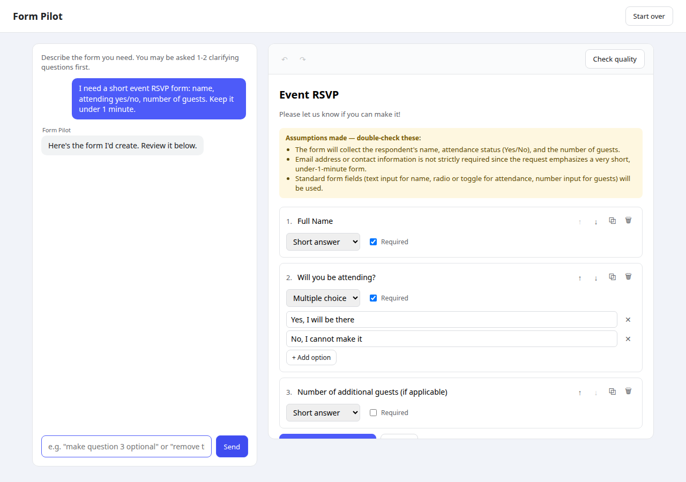
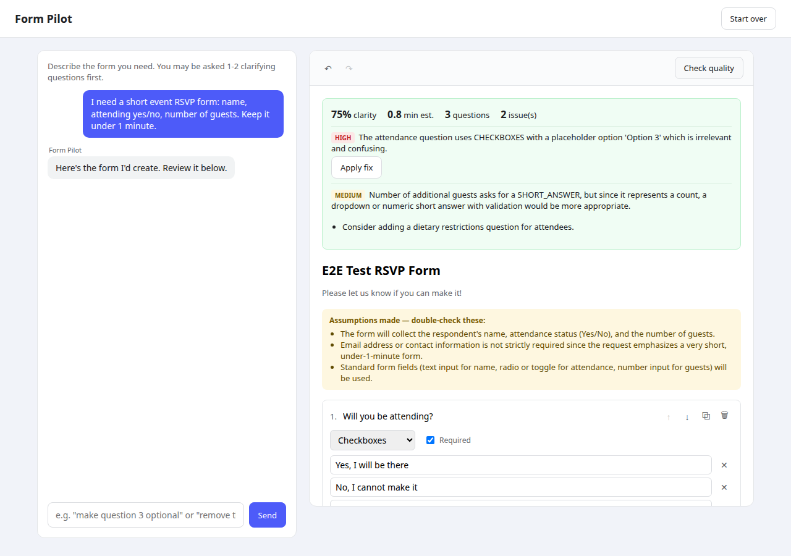
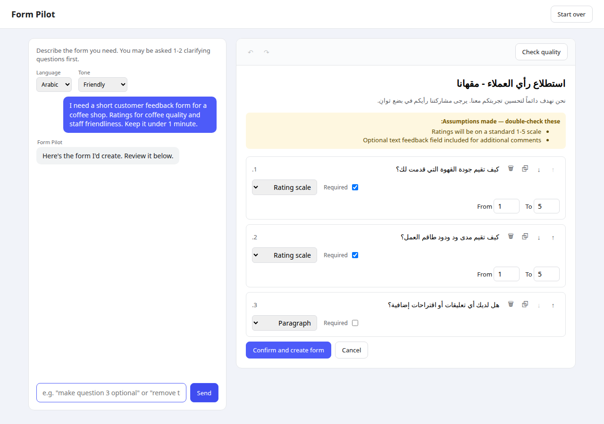
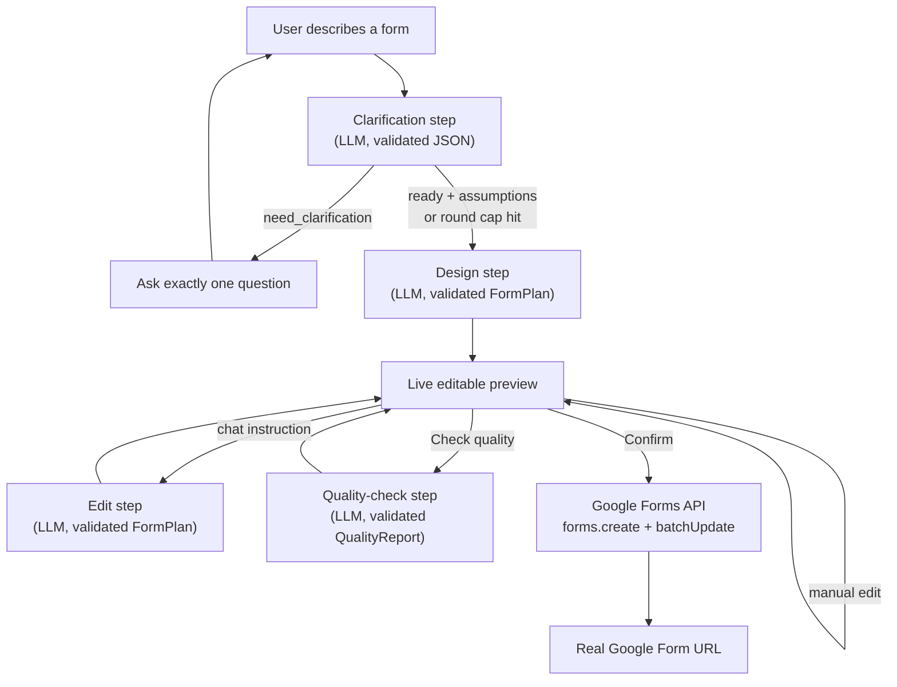

# Form Pilot

An AI agent that turns a plain-language request ("I need a customer satisfaction
survey for my restaurant, under 2 minutes") into a real, live Google Form — asking
clarifying questions only when it genuinely needs to, and never touching the Google
Forms API with anything that hasn't passed schema validation first.

Built as a learning project to explore what actually separates an "AI agent" from a
chat UI glued to an LLM API.

## What makes this an agent, not a chatbot wrapper

A thin wrapper would be: `user text → one LLM call → show the output`. That's not
what's happening here. Every LLM call in this system:

1. Has **one narrow job** (decide whether to ask a question, design a form, apply an
   edit, or assess quality) instead of one prompt doing everything.
2. **Must return JSON matching a specific Pydantic schema.** If it doesn't, the raw
   output is never shown to the user or passed downstream — the error is fed back to
   the LLM and it's asked to try again, up to a retry limit.
3. Only after validation succeeds does the result get used — to ask a question, to
   update the form preview, or (at confirmation) to actually call the Google Forms
   API and create a real form.

The "max 2 clarification rounds" rule is a good example of the philosophy: it's
stated in the prompt, but it's **also enforced in code** regardless of what the model
does. In testing, the model occasionally ignored the instruction and tried to ask a
third question anyway — the code overrides it and moves on. The prompt is a
suggestion; the validation and control flow are what's actually reliable.

## Demo

**Live editable preview** — every question can be retitled, retyped, reordered,
duplicated, or deleted by hand, in sync with the AI conversation:



**AI quality check** — a dedicated LLM pass scores clarity, flags concrete issues
(duplicate questions, a question type that doesn't fit its content, unnecessarily
required fields), and lets you apply a suggested fix with one click:



**Multilingual + tone-aware generation**, including automatic RTL layout for Arabic:



## Architecture



Every arrow into a box labeled "LLM" passes through the same choke point: a
`TypeAdapter(...).validate_json(...)` call against a Pydantic model, with an
automatic retry-with-the-validation-error-appended loop if it fails. Nothing
downstream ever sees unvalidated model output.

Conversation and form state live in an in-memory dict keyed by a client-generated
session ID (`app/session_store.py`) — no database. That's a deliberate choice for a
single-user tool with no accounts; see [Limitations](#known-limitations) if you're
thinking about running this for multiple people.

## Features

- Natural-language form creation, with clarifying questions capped at 2 rounds
  (enforced in code, not just prompted)
- Automatic question-type selection (short answer, paragraph, multiple choice,
  checkboxes, dropdown, linear scale) based on content, not just user phrasing
- Live, directly-editable preview: retitle, retype, reorder, duplicate, delete,
  edit options/scale — synced to the server on every change
- Conversational editing ("make question 3 optional", "remove the email question")
  that patches the existing plan instead of regenerating it
- AI quality check with clarity score, concrete issues, and one-click fixes
- Undo/redo across both manual and AI edits
- Multilingual generation (English/Arabic/French) with automatic RTL layout, plus
  selectable tone (professional, friendly, casual, academic, corporate, marketing,
  formal)
- Real Google Forms creation via the Forms API — not a mockup

## Tech stack

- **Backend:** Python, FastAPI, Pydantic
- **LLM:** Gemini (`google-genai`), structured JSON output
- **Frontend:** vanilla HTML/CSS/JS — no framework, no build step
- **Forms:** Google Forms API v1 (OAuth 2.0, Desktop app flow)

No LangChain, no agent framework — the "agent loop" is plain Python functions
(`app/agent.py`) orchestrating validated LLM calls and one external tool
(`create_google_form`). Kept intentionally simple and readable end to end.

## Project structure

```
form-pilot/
├── app/
│   ├── main.py            # FastAPI routes
│   ├── agent.py            # orchestration: clarify → design → edit → confirm, undo/redo
│   ├── llm.py               # Gemini calls, one function per pipeline step, all validated
│   ├── models.py            # Pydantic schemas (FormPlan, QualityReport, etc.)
│   ├── google_forms.py       # OAuth + Forms API tool (create_google_form)
│   └── session_store.py       # in-memory session state
├── frontend/
│   ├── index.html            # split-pane chat + live preview UI
│   └── app.js
├── scripts/                  # standalone checks that hit the real Gemini/Forms APIs
│   ├── check_models.py        # schema validation sanity checks (no API calls)
│   ├── check_llm.py            # clarification/design steps
│   ├── check_quality.py         # quality-check step
│   ├── check_multilingual.py     # language/tone generation
│   ├── check_google_forms.py      # end-to-end real form creation
│   └── authorize.py               # one-time OAuth flow
├── credentials/               # gitignored: client_secret.json, token.json
└── requirements.txt
```

## Setup

### 1. Prerequisites

- Python 3.12+
- A Google account
- A [Gemini API key](https://aistudio.google.com/) (free tier is enough)

### 2. Google Cloud setup

1. Create a project at [console.cloud.google.com](https://console.cloud.google.com/projectcreate).
2. Enable the **Google Forms API** for that project.
3. Configure the **OAuth consent screen**: User type = External, add scope
   `https://www.googleapis.com/auth/forms.body`, add yourself as a **Test user**,
   leave publishing status as **Testing** (no Google verification needed for
   personal use — see [Limitations](#known-limitations)).
4. Create an **OAuth client ID**, application type **Desktop app**, and download the
   JSON as `credentials/client_secret.json`.

### 3. Install dependencies

```bash
python3 -m venv .venv
source .venv/bin/activate
pip install -r requirements.txt
```

### 4. Configure environment

```bash
cp .env.example .env
# edit .env and set GEMINI_API_KEY
```

### 5. Authorize once

```bash
python -m scripts.authorize
```

This opens a browser for the Google consent screen and saves
`credentials/token.json`. You'll need to repeat this roughly every 7 days while the
app is in OAuth Testing mode (a Google limitation, not this app's).

### 6. Run

```bash
uvicorn app.main:app --reload
```

Open `http://127.0.0.1:8000`.

## Usage

Describe the form you want. Form Pilot will ask up to two clarifying questions if
something important is missing, then show a live preview you can edit by hand or by
chatting ("make it shorter", "add a rating question"). Run the quality check if you
want a second opinion before publishing, then click **Confirm and create form** to
create the real Google Form and get its link.

## Known limitations

- **Single Google account.** All forms are created under whoever ran
  `scripts/authorize.py`. There's no per-user sign-in — fine for personal use, not
  suitable for letting other people use a shared deployment without further work.
- **No session ownership check.** Session IDs are client-generated with no auth
  behind them. Not a concern running this yourself locally; would need addressing
  before any multi-user deployment.
- **OAuth Testing mode.** Refresh tokens expire after 7 days, and the consent
  screen supports at most 100 test users. Moving to "In production" removes both
  limits but requires Google's verification review (a real external process — see
  [Google's OAuth verification docs](https://support.google.com/cloud/answer/13463073)).
- **In-memory state.** Conversation and draft-form state resets on server restart.
  Deliberate for a no-database single-user MVP.
- **Response analytics aren't implemented.** Google's Forms API doesn't expose
  completion rate, average completion time, or drop-off points for *any* app — only
  submitted responses. A future analytics feature would report what's actually
  available (response counts, per-question answer breakdowns, AI-generated
  qualitative analysis) rather than fabricate numbers Google doesn't provide.
